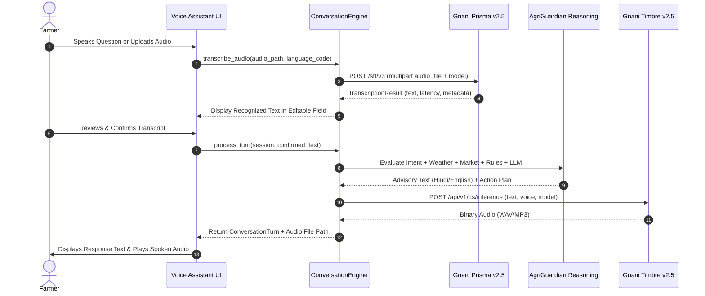

# AgriGuardian — System Architecture Documentation

**System:** AgriGuardian (Your Intelligent Agricultural Companion)  
**Version:** 2.0 (Phase 0 & Phase 1 Architecture)  
**Target Audience:** Software Architects, AI Engineers, and Agricultural Systems Developers  

---

## 1. Architectural Overview

AgriGuardian is an AI-powered agricultural intelligence companion built for Indian farmers. The application is structured around a modular, layered architecture that strictly separates presentation, conversation orchestration, domain-specific agricultural reasoning, third-party provider integrations, and local persistence.

```mermaid
flowchart TD
    subgraph UI ["Frontend / Presentation Layer (Streamlit)"]
        VUI["🎙️ Voice Assistant View"]
        HUI["🏠 Farm Advisory View"]
        DUI["📊 Field Officer Dashboard"]
        CUI["👨‍🌾 Demo Cases View"]
        WID["Custom UI Components & Folium Map"]
    end

    subgraph Core ["Core Infrastructure & Schemas"]
        CONF["Pydantic Settings & Catalogs (config.py)"]
        LOG["Structured Redacted Logging (logging.py)"]
        EXC["Custom Exceptions Hierarchy (exceptions.py)"]
        SCH["Pydantic Domain Schemas (schemas/)"]
    end

    subgraph Services ["Application & Reasoning Services"]
        CONV["Voice Conversation Engine (engine.py)"]
        ORCH["AgriGuardian System Orchestrator (orchestrator.py)"]
        RULE["Dynamic Agricultural Rule Engine (rule_engine.py)"]
        DISEASE["Plant Disease & Severity Service (disease_detector.py)"]
        REP["ReportLab PDF Document Engine (pdf_generator.py)"]
        ANL["Dashboard Analytics Engine (dashboard.py)"]
    end

    subgraph Integrations ["Third-Party & Provider Integrations"]
        PRISMA["Gnani Prisma v2.5 STT Client (POST /stt/v3)"]
        TIMBRE["Gnani Timbre v2.5 TTS Client (POST /api/v1/tts/inference)"]
        AUDIO_U["Audio Format Validator & Cleaner (audio_utils.py)"]
        WEATHER["Open-Meteo REST Weather Service"]
        MARKET["Agmarknet Indicative Benchmark Service"]
        LLM["LLM Advisory Service (OpenAI / Evon Extensible)"]
    end

    subgraph Persistence ["Persistence Layer"]
        REPO["DataManager (data_manager.py)"]
        CSV[("advisories.csv")]
        RULES[("rules.json")]
    end

    VUI --> CONV
    HUI --> ORCH
    DUI --> ANL
    CUI --> ORCH

    CONV --> PRISMA
    CONV --> TIMBRE
    CONV --> ORCH
    PRISMA --> AUDIO_U
    TIMBRE --> AUDIO_U

    ORCH --> RULE
    ORCH --> DISEASE
    ORCH --> WEATHER
    ORCH --> MARKET
    ORCH --> LLM
    ORCH --> REP
    ORCH --> REPO

    ANL --> REPO
    REPO --> CSV
    RULE --> RULES
    CONF -.-> Services
    CONF -.-> Integrations
```

---

## 2. Layer Responsibilities & Boundaries

### 2.1 Presentation Layer (`frontend/`)
* **Views (`frontend/views/`):**
  * `voice_assistant_view.py`: Main entrypoint for multilingual speech queries. Manages audio recording, file uploads, transcript verification, streaming audio playback, and multi-turn message history.
  * `home_view.py`: Classical form-based advisory interface with GPS farm coordinate picker, symptom description, optional leaf photo upload, and PDF download.
  * `dashboard_view.py`: Aggregates regional disease outbreaks, risk distributions, and agronomist case review tools.
  * `demo_cases_view.py`: Pre-configured case studies (Wheat, Cotton, Tomato) for immediate demonstration.
  * `about_view.py`: Architectural documentation and language support catalog.
* **Components (`frontend/components/`):** Reusable status badges, alert banners, metric cards, and Folium geospatial maps.
* **Separation Rule:** UI components never make direct external HTTP requests; they interact exclusively with service interfaces (`ConversationEngine`, `AgriGuardianSystem`).

### 2.2 Core Infrastructure (`backend/app/core/`)
* `config.py`: Centralized, typed configuration using `pydantic-settings`. Loads environment variables from `.env` or system environment. Manages verified catalogs for languages (`SUPPORTED_LANGUAGES`) and voices (`TIMBRE_V25_VOICES`).
* `logging.py`: Structured application logging with automatic credential redaction to prevent secret leakage.
* `exceptions.py`: Hierarchical exceptions (`GnaniAPIError`, `WeatherAPIError`, `ValidationError`, etc.) providing precise error categorization.

### 2.3 Conversation & Reasoning Services (`backend/app/services/`)
* **`services/conversation/engine.py`:**
  * Coordinates speech transcription via Gnani Prisma v2.5.
  * Classifies agricultural query intent (disease, weather, market, general agronomy).
  * Injects active session dialogue history into context.
  * Invokes agricultural advisory reasoning.
  * Synthesizes spoken voice audio via Gnani Timbre v2.5 in the farmer's target language.
* **`services/advisory/orchestrator.py`:**
  * Coordinates multi-source evidence (micro-climate weather, market trends, expert rules, and LLM advice).
  * Generates PDF reports and persists case records.
* **`services/agriculture/rule_engine.py`:**
  * Configurable dynamic expert system evaluating condition trees against symptom keywords and weather flags.
* **`services/agriculture/disease_detector.py`:**
  * Disease diagnosis and compound environmental severity calculation with Grad-CAM salience visualization.

### 2.4 Integration Layer (`backend/app/integrations/`)
* **`gnani/`:**
  * `client.py`: Base HTTP client providing authentication headers (`X-API-Key-ID`), exponential backoff retries, and network timeout protection.
  * `prisma_stt.py`: Official REST integration for Gnani Prisma v2.5 (`POST https://api.vachana.ai/stt/v3`).
  * `timbre_tts.py`: Official REST integration for Gnani Timbre v2.5 (`POST https://api.vachana.ai/api/v1/tts/inference`).
  * `audio_utils.py`: MIME and magic-byte format validation, temporary storage, and TTL cleanup.
* **`weather/`:** Open-Meteo REST API client with 3-day meteorological forecasts and circuit-breaker fallback.
* **`market/`:** Transparent agricultural pricing intelligence with source attribution and trend analysis.
* **`llm/`:** OpenAI GPT-3.5 client with custom HTTP client (eliminating Python 3.14 / httpx proxy incompatibilities) and agricultural safety guardrails.

---

## 3. Data Flow Sequences

### 3.1 Multilingual Voice Conversation Workflow

---

## 4. Security & Privacy Architecture

1. **Credential Isolation:** API keys are never stored in client state, passed to browser sessions, or written to logs. The `SensitiveDataFilter` automatically scrubs credentials from log outputs.
2. **Audio Data Minimization:** Voice recordings and synthesized audio files are written to safe temporary directories with randomized UUIDs. The `cleanup_temporary_files` utility purges files exceeding retention TTL.
3. **Graceful Degraded States:** If external AI services are unreachable or unconfigured, the system never crashes. It transparently communicates status and falls back to deterministic rule-based advice.
4. **Agricultural Safety Guardrails:** Prevents hallucinated toxic chemical dosages; mandates expert referral when high risk or diagnostic uncertainty is detected.

---

## 5. Future Evolution & Roadmap

* **FastAPI Headless Backend:** The modular separation in `backend/app/` allows mounting a FastAPI REST/WebSocket server without touching business logic.
* **PostgreSQL / TimescaleDB Migration:** The repository abstraction (`DataManager`) allows swapping the CSV persistence for an enterprise relational database with minimal refactoring.
* **Gnani Evon v3.3 Reasoning:** The `LLMAdvisorService` is decoupled, allowing plug-and-play adoption of Gnani's upcoming Evon agricultural LLM model.
* **eNAM Live Mandi Integration:** The `MarketService` provides an extensible interface ready to connect to live APMC / eNAM mandi APIs.

