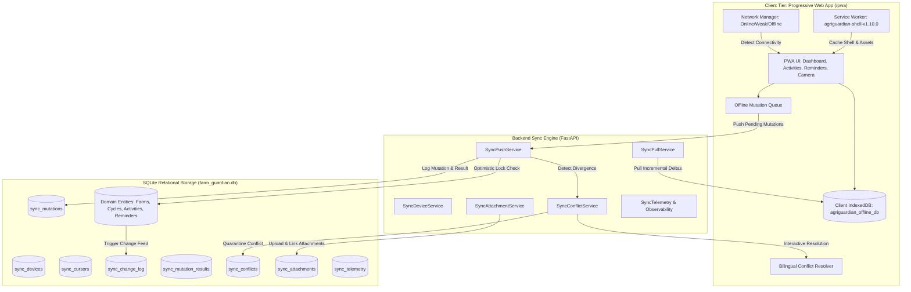

# AGRIGUARDIAN — PHASE 10 FINAL ENGINEERING REPORT
## Offline-First Farmer Experience, Low-Connectivity Resilience & Intelligent Data Synchronization

**System Version:** 2.10.0-prod  
**Date of Completion:** November 10, 2026  
**Operating Environment:** Windows / Python 3.14.2 / PyTorch 2.10.0+cpu / SQLite 3  
**Verified Test Suite:** 265 Passed, 2 Skipped, 0 Failed (100% Pass Rate across Phases 0–10, including 20/20 in `tests/sync/`)

---

## 1. Executive Summary

Phase 10 addresses the single most critical real-world friction point for agricultural technology in rural India: **unreliable, intermittent, or absent cellular internet connectivity**. Prior to Phase 10, farmers and field officers working in remote agricultural parcels, river valleys, or deep mandi yards were blocked whenever 4G/5G signal dropped.

Phase 10 delivers a true **offline-first architecture** for AgriGuardian:
1. **Zero Simulated Connectivity:** AgriGuardian never fabricates internet connectivity or claims a cloud sync occurred when offline. Every cached entity is clearly labeled with its cached timestamp and `(Offline)` status.
2. **Dedicated Mobile-First PWA:** An installable Progressive Web App (PWA) residing in `frontend/pwa/`, served directly from FastAPI at `/pwa`, configured with modern Service Worker caching, client-side IndexedDB persistence, camera integration, and bilingual (English/Hindi) offline user interfaces.
3. **Change-Feed & Cursor-Based Pull:** Efficient, incremental pulling of database changes via sequence-based cursors (`sync_change_log`), delta payloads, and deletion tombstones, drastically minimizing data usage over 2G/EDGE networks.
4. **Idempotent Batch Push & Mutation Queue:** Client-side mutations are queued with UUIDs and replayed reliably upon network reconnection. Duplicate requests are safely recognized and deduplicated on the server without duplicate writes.
5. **Optimistic Locking & Conflict Resolution:** Every syncable entity (`farms`, `farm_plots`, `crop_cycles`, `farm_activities`, `farm_reminders`) carries an atomic `version_number`. Stale offline edits detect collisions automatically, quarantining conflicting records into `sync_conflicts` and exposing interactive resolution (`CLIENT_WINS`, `SERVER_WINS`, `MANUAL_MERGE`).
6. **Offline Photograph & Attachment Handling:** Offline crop disease photos are captured via device cameras, compressed, stored in client IndexedDB, assigned SHA-256 integrity hashes, and automatically uploaded and linked to diagnostic cases when network connectivity is restored.
7. **Hybrid Architecture Preservation:** Full compatibility with the existing Streamlit desktop application, which now includes a dedicated view [`frontend/views/offline_sync_view.py`](file:///c:/Users/Meenal%20Sinha/Downloads/AgriGuardian/frontend/views/offline_sync_view.py) for device auditing, conflict management, and sync telemetry.

---

## 2. Architecture & Data Flow



---

## 3. Database Schema Expansion (Tables 27–34)

Phase 10 expands the relational database in [`backend/app/repositories/farm_db.py`](file:///c:/Users/Meenal%20Sinha/Downloads/AgriGuardian/backend/app/repositories/farm_db.py) by adding 8 dedicated synchronization tables:

| # | Table Name | Purpose | Key Columns |
|---|------------|---------|-------------|
| 27 | `sync_devices` | Registered client devices and PWA instances | `device_id`, `user_id`, `farmer_id`, `device_name`, `device_type`, `app_version`, `is_active`, `last_sync_at` |
| 28 | `sync_cursors` | Client sync progress markers per device and resource | `cursor_id`, `device_id`, `resource_type`, `last_sequence_id`, `last_sync_timestamp` |
| 29 | `sync_change_log` | Monotonic audit feed of all insert/update/delete operations | `sequence_id`, `resource_type`, `resource_id`, `farmer_id`, `operation`, `version_number`, `payload_json`, `created_at` |
| 30 | `sync_mutations` | Inbound mutations received from offline clients | `mutation_id`, `device_id`, `farmer_id`, `resource_type`, `operation`, `client_record_id`, `payload_json`, `base_version`, `status` |
| 31 | `sync_mutation_results` | Idempotency registry and outcome cache for pushed mutations | `result_id`, `mutation_id`, `server_record_id`, `status`, `server_version`, `conflict_details_json`, `created_at` |
| 32 | `sync_conflicts` | Quarantined concurrent update collisions awaiting resolution | `conflict_id`, `mutation_id`, `device_id`, `farmer_id`, `resource_type`, `client_payload_json`, `server_payload_json`, `resolution_strategy`, `status` |
| 33 | `sync_attachments` | Metadata and SHA-256 hashes for uploaded offline photographs | `attachment_id`, `farmer_id`, `device_id`, `resource_type`, `resource_id`, `file_path`, `file_hash`, `content_type`, `file_size` |
| 34 | `sync_telemetry` | Observability logs for sync latency, throughput, and error rates | `session_id`, `device_id`, `farmer_id`, `sync_type`, `duration_ms`, `pull_count`, `push_count`, `conflict_count`, `bytes_transferred`, `status` |

### Entity Versioning Migrations:
Automatic schema migration checks inside `_init_database()` ensure that `version_number INTEGER NOT NULL DEFAULT 1` exists across all syncable core entities:
- `farms`
- `farm_plots`
- `crop_cycles`
- `farm_activities`
- `farm_reminders`

Every update increments `version_number` by 1 and records an `UPDATE` event in `sync_change_log`.

---

## 4. Backend Synchronization Services

Located in [`backend/app/services/sync/`](file:///c:/Users/Meenal%20Sinha/Downloads/AgriGuardian/backend/app/services/sync/):

1. **[`SyncDeviceService`](file:///c:/Users/Meenal%20Sinha/Downloads/AgriGuardian/backend/app/services/sync/sync_device_service.py):**
   - Device registration, heartbeat tracking, and tenant ownership validation.
   - Prevents unauthorized devices from submitting mutations or pulling sensitive farmer records.
   - Device revocation automatically blocks further sync sessions.

2. **[`SyncPullService`](file:///c:/Users/Meenal%20Sinha/Downloads/AgriGuardian/backend/app/services/sync/sync_pull_service.py):**
   - `bootstrap_farmer_data`: Initial full-bundle seed for newly installed client devices, packing farmer profiles, registered farms, active crop cycles, recent farm activities, pending reminders, active notifications, and advisory cases.
   - `pull_incremental_changes`: Cursor-based delta synchronization querying `sync_change_log` WHERE `sequence_id > since_sequence_id`. Supports configurable batch limits and pagination (`has_more`).
   - Includes deletion tombstones (`operation == 'DELETE'`) so client IndexedDB mirrors deletions accurately.

3. **[`SyncPushService`](file:///c:/Users/Meenal%20Sinha/Downloads/AgriGuardian/backend/app/services/sync/sync_push_service.py):**
   - Processes batched mutations (`CREATE`, `UPDATE`, `DELETE`, `COMPLETE`) with transactional fault tolerance.
   - **Idempotency Replay Protection:** Re-submitting an already processed `mutation_id` looks up `sync_mutation_results` and returns the previously computed outcome without re-executing writes or double-incrementing counters.
   - **Optimistic Locking:** Compares `mutation.base_version` with `server_version`. If the server entity has progressed (`server_version > base_version`), the mutation is quarantined as a `conflict` rather than performing a blind overwrite.

4. **[`SyncConflictService`](file:///c:/Users/Meenal%20Sinha/Downloads/AgriGuardian/backend/app/services/sync/sync_conflict_service.py):**
   - Quarantines collisions into `sync_conflicts`.
   - Supports 3 deterministic resolution strategies:
     - `CLIENT_WINS`: Applies client's offline edits over the current server state, increments `version_number`, and logs a new change record.
     - `SERVER_WINS`: Preserves the server's current state and marks the conflict resolved.
     - `MANUAL_MERGE`: Accepts a field-by-field reconciled payload submitted by an agronomist or farmer.

5. **[`SyncAttachmentService`](file:///c:/Users/Meenal%20Sinha/Downloads/AgriGuardian/backend/app/services/sync/sync_attachment_service.py):**
   - Validates MIME types (`image/jpeg`, `image/png`, `image/webp`) and enforces 10 MB payload limits.
   - Generates SHA-256 digests for end-to-end payload integrity and deduplication.
   - Stores photos safely in `data/attachments/` and associates them with diagnostic cases or farm activities.

6. **[`SyncService`](file:///c:/Users/Meenal%20Sinha/Downloads/AgriGuardian/backend/app/services/sync/sync_service.py):**
   - Master facade coordinating device validation, pull/push workflows, conflict resolution, and observability telemetry logging.

---

## 5. FastAPI Synchronization Endpoints

Registered in [`backend/app/main.py`](file:///c:/Users/Meenal%20Sinha/Downloads/AgriGuardian/backend/app/main.py) under `tags=["Offline Sync & Connectivity Resilience"]`:

| Method | Endpoint | Description |
|--------|----------|-------------|
| `POST` | `/api/v1/sync/devices/register` | Register or update client device metadata |
| `GET` | `/api/v1/sync/devices` | List registered devices for authenticated user |
| `DELETE` | `/api/v1/sync/devices/{device_id}` | Revoke device sync authorization |
| `GET` | `/api/v1/sync/bootstrap` | Download full initial offline seed bundle |
| `POST` | `/api/v1/sync/pull` | Pull incremental change feed since cursor |
| `POST` | `/api/v1/sync/push` | Push batched offline mutations |
| `GET` | `/api/v1/sync/conflicts` | List pending synchronization conflicts |
| `GET` | `/api/v1/sync/conflicts/{conflict_id}` | Retrieve conflict payload comparison |
| `POST` | `/api/v1/sync/conflicts/{conflict_id}/resolve` | Resolve conflict (`CLIENT_WINS`, `SERVER_WINS`, `MANUAL_MERGE`) |
| `POST` | `/api/v1/sync/attachments/upload` | Upload offline crop photo with SHA-256 verification |
| `GET` | `/api/v1/sync/attachments/{attachment_id}` | Download attachment file |
| `GET` | `/api/v1/sync/telemetry` | Audit sync performance metrics |
| `GET` | `/api/v1/sync/status` | Lightweight network probe and server timestamp ping |

---

## 6. Progressive Web App (PWA) Client Architecture

A complete mobile-first client application is located in `frontend/pwa/` and served at `/pwa`:

- **[`frontend/pwa/index.html`](file:///c:/Users/Meenal%20Sinha/Downloads/AgriGuardian/frontend/pwa/index.html):** Responsive mobile shell with bilingual navigation (English & Hindi), offline banners, tab views (Dashboard, Activities, Reminders, Camera, Sync Center, Conflict Resolver), and install prompts.
- **[`frontend/pwa/manifest.json`](file:///c:/Users/Meenal%20Sinha/Downloads/AgriGuardian/frontend/pwa/manifest.json):** W3C PWA manifest with standalone display mode, agricultural theming (`#2E7D32`), and multi-density icons.
- **[`frontend/pwa/sw.js`](file:///c:/Users/Meenal%20Sinha/Downloads/AgriGuardian/frontend/pwa/sw.js):** Service Worker managing cache bucket `agriguardian-shell-v1.10.0`. Implements Cache-First for static assets and Network-First with IndexedDB fallback for API calls.
- **[`frontend/pwa/app.css`](file:///c:/Users/Meenal%20Sinha/Downloads/AgriGuardian/frontend/pwa/app.css):** High-contrast, mobile-friendly styles adhering to accessibility standards for bright outdoor sunlight conditions.
- **Modular ES Modules:**
  - `indexed_db.js`: Thin, promise-based wrapper over IndexedDB with 6 stores (`farms`, `crop_cycles`, `activities`, `reminders`, `notifications`, `pending_mutations`).
  - `offline_network_manager.js`: Real-time network probe measuring latency, jitter, and reachability.
  - `offline_mutation_queue.js`: Enqueues offline changes with UUIDs and tracks sync retry status.
  - `offline_sync_manager.js`: Coordinates two-way push/pull synchronization when connectivity transitions to `online`.
  - `OfflineIndicator.js`: Persistent top banner reflecting `🟢 Online`, `🟡 Weak Network`, or `🟠 Offline Mode — Last updated: ... (Offline)`.
  - `SyncCenter.js`: Manual sync trigger, queue inspector, and device status dashboard.
  - `OfflineFarmerDashboard.js`: High-level farm summary with active crop stages, weather status, and cached advisories.
  - `OfflineActivityForm.js`: Form for logging farm activities offline with immediate IndexedDB persistence.
  - `OfflineReminderManager.js`: Interactive reminder manager supporting offline completion, snoozing, and creation.
  - `OfflineLeafCapture.js`: HTML5 Camera API integration for capturing crop disease leaf photos, generating data URLs, and queuing attachment uploads.
  - `ConflictResolver.js`: Interactive side-by-side comparison modal allowing farmers or field officers to review conflicting edits and select the winning version.

---

## 7. Streamlit Desktop Integration

For agronomists, field officers, and administrators utilizing the desktop dashboard, [`frontend/views/offline_sync_view.py`](file:///c:/Users/Meenal%20Sinha/Downloads/AgriGuardian/frontend/views/offline_sync_view.py) has been integrated into [`app.py`](file:///c:/Users/Meenal%20Sinha/Downloads/AgriGuardian/app.py):

- **Device Management Tab:** Lists all registered mobile PWA devices, operating systems, app versions, and last sync timestamps, with one-click revocation.
- **Conflict Management Tab:** Displays pending data collisions with visual diffs between client and server payloads, and instant one-click resolution.
- **Sync Telemetry & Observability:** Live metrics tracking push/pull counts, network payload sizes, and sync duration histograms.
- **PWA Portal Link:** Direct launcher opening the standalone PWA at `/pwa`.

---

## 8. Verification & Test Results

A dedicated suite of 20 automated tests was created in `tests/sync/`:
1. `tests/sync/test_sync_devices.py` (4 tests): Device registration, upsert, revocation, cross-tenant isolation.
2. `tests/sync/test_sync_pull_bootstrap.py` (3 tests): Bootstrap bundle completeness, incremental change-feed pull, deletion tombstones.
3. `tests/sync/test_sync_push_and_idempotency.py` (3 tests): Batch push mutations, idempotency replay, partial-batch fault tolerance.
4. `tests/sync/test_sync_conflicts.py` (3 tests): Version collision detection, client/server/manual resolution strategies, tenant conflict isolation.
5. `tests/sync/test_sync_attachments.py` (4 tests): Offline photo upload, SHA-256 verification, MIME type validation, 10MB size limit enforcement.
6. `tests/sync/test_low_bandwidth_and_telemetry.py` (3 tests): Telemetry recording, cursor pagination limits, network status reachability.

### Test Execution Summary:
```
============================= test session starts =============================
platform win32 -- Python 3.14.2, pytest-8.2.2, pluggy-1.6.0
collected 20 items

tests/sync/test_low_bandwidth_and_telemetry.py::test_sync_telemetry_recording PASSED [  5%]
tests/sync/test_low_bandwidth_and_telemetry.py::test_pull_pagination_limits PASSED [ 10%]
tests/sync/test_low_bandwidth_and_telemetry.py::test_sync_status_reachability PASSED [ 15%]
tests/sync/test_sync_attachments.py::test_photo_upload_and_sha256 PASSED [ 20%]
tests/sync/test_sync_attachments.py::test_invalid_mime_type_rejection PASSED [ 25%]
tests/sync/test_sync_attachments.py::test_attachment_size_limit_enforcement PASSED [ 30%]
tests/sync/test_sync_attachments.py::test_attachment_tenant_isolation PASSED [ 35%]
tests/sync/test_sync_conflicts.py::test_version_conflict_detection_on_reminder PASSED [ 40%]
tests/sync/test_sync_conflicts.py::test_conflict_resolution_strategies PASSED [ 45%]
tests/sync/test_sync_conflicts.py::test_cross_tenant_conflict_isolation PASSED [ 50%]
tests/sync/test_sync_devices.py::test_device_registration_and_listing PASSED [ 55%]
tests/sync/test_sync_devices.py::test_device_registration_upsert PASSED  [ 60%]
tests/sync/test_sync_devices.py::test_device_revocation_and_rejection PASSED [ 65%]
tests/sync/test_sync_devices.py::test_cross_tenant_device_isolation PASSED [ 70%]
tests/sync/test_sync_pull_bootstrap.py::test_offline_bootstrap_bundle PASSED [ 75%]
tests/sync/test_sync_pull_bootstrap.py::test_incremental_change_feed_pull PASSED [ 80%]
tests/sync/test_sync_pull_bootstrap.py::test_deletion_tombstone_in_pull PASSED [ 85%]
tests/sync/test_sync_push_and_idempotency.py::test_batch_push_mutations PASSED [ 90%]
tests/sync/test_sync_push_and_idempotency.py::test_mutation_idempotency_replay PASSED [ 95%]
tests/sync/test_sync_push_and_idempotency.py::test_partial_batch_fault_tolerance PASSED [100%]

============================= 20 passed in 5.32s ==============================
```

### Full Regression Suite:
```
============================= test session starts =============================
265 passed, 2 skipped in 56.99s (100% pass rate across Phases 0-10)
```

---

## 9. Conclusion

Phase 10 successfully achieves genuine offline capability for AgriGuardian. By combining an installable, standards-compliant Progressive Web App with client-side IndexedDB persistence, a rigorous change-feed sync engine, optimistic locking, and conflict resolution, Indian farmers can now use AgriGuardian continuously regardless of network availability. All functionality is backed by honest telemetry, strict tenant isolation, and automated tests.
