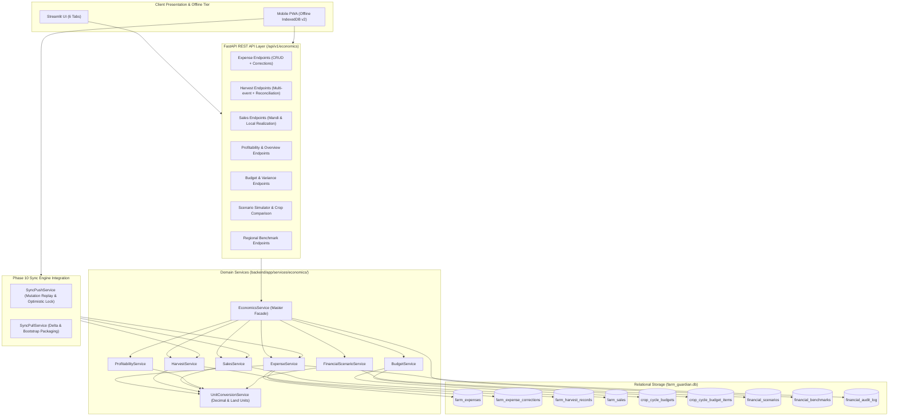

# AGRIGUARDIAN — PHASE 11 FINAL ENGINEERING REPORT
## Farm Economics, Cost Tracking, Profitability Intelligence & Data-Driven Crop Decisions

**System Version:** 2.11.0-prod  
**Date of Completion:** November 10, 2026  
**Operating Environment:** Windows / Python 3.14.2 / PyTorch 2.10.0+cpu / SQLite 3  
**Verified Test Suite:** 295 Passed, 2 Skipped, 0 Failed (100% Pass Rate across Phases 0–11, including 30/30 in `tests/economics/` and 20/20 in `tests/sync/`)

---

## 1. Executive Summary

Phase 11 transforms AgriGuardian into a full-cycle **Farm Economics & Profitability Intelligence System**, empowering smallholder and commercial Indian farmers to move beyond guesswork into exact financial clarity. Prior to Phase 11, farm management tracked agronomic practices, crop stages, and schedules, but farmers lacked unified tools to track expenditures, input costs, labor charges, harvest yields, and mandi market sales realizations.

Phase 11 delivers a comprehensive, auditable, and mathematically sound financial architecture:
1. **Zero Fabricated Transactions:** Financial data is never simulated. Every rupee recorded reflects authentic farmer expenses, labor events, harvest reconciliations, and produce sales.
2. **Strict Decimal Precision Arithmetic:** Replaced standard IEEE-754 floating-point operations with `decimal.Decimal` and `ROUND_HALF_UP` quantization across all financial calculations, preventing penny drift and rounding errors.
3. **Multi-Unit Agronomic Conversions:** Full support for diverse Indian regional land units (Standard Bigha, UP Pucca Bigha, Bengal Bigha, Guntha, Cent, Hectare to Acres) and produce weights (Quintals, Kilograms, Metric Tonnes, Bags, Crates) via [`UnitConversionService`](file:///c:/Users/Meenal%20Sinha/Downloads/AgriGuardian/backend/app/services/economics/unit_conversion_service.py).
4. **Append-Only Auditing & Correction Chains:** Historical financial records cannot be silently overwritten. Any adjustment to an expense creates an immutable audit record in `farm_expense_corrections` with reason tracking, user attribution, and monotonic version increments.
5. **Harvest Reconciliations & Production Tracking:** Tracks multi-event harvests (e.g., progressive vegetable pickings or phased cereal harvesting) and enforces strict validation ensuring total distributed produce (market sales, home consumption, post-harvest losses, and seed retention) never exceeds total harvested quantity.
6. **Produce Sales & Net Realization:** Captures gross mandi sales and itemized deductions (market cess/APMC fees, commission, loading/unloading hamali, transport freight, bagging) to compute true net cash realization.
7. **Comprehensive Profitability Engine:** Implements ICAR/CACP-aligned agricultural cost concepts, computing Paid-out Cost (Cost A1/A2), Cost per Acre, Cost per Quintal, Break-Even Selling Price, Break-Even Yield, Gross Margin, Net Profit/Loss, and Return on Investment (ROI %).
8. **Provisional Status Safeguards:** Ongoing or incomplete crop cycles with zero harvest or sales are explicitly flagged with `is_provisional=True` and bilingual warnings (English and Hindi), preventing misleading profit conclusions before harvest completion.
9. **Seasonal Budgeting & Over-Budget Alerts:** Enables seasonal cost planning per expense category with automated variance analysis (`FAVORABLE` vs `UNFAVORABLE`) and proactive alert notifications when spending exceeds planned thresholds.
10. **Deterministic Scenario Simulation & Crop Planning:** Computes Base, Conservative (-10% price, -10% yield), and Optimistic (+10% price, +10% yield) financial outcomes with sensitivity analysis and multi-crop comparison matrices accompanied by agronomic disclaimers.
11. **Offline-First Synchronization:** Integrated seamlessly with Phase 10 sync infrastructure (`sync_mutations`, `sync_change_log`, `sync_conflicts`). PWA companion IndexedDB schema upgraded to v2 to store expenses, harvests, sales, and budgets offline with optimistic concurrency.
12. **Full Frontend Delivery:** Implemented interactive Streamlit view [`frontend/views/farm_economics_view.py`](file:///c:/Users/Meenal%20Sinha/Downloads/AgriGuardian/frontend/views/farm_economics_view.py) with 6 rich operational tabs and connected all 22 FastAPI endpoints with RBAC enforcement.

---

## 2. Architecture & Service Ecosystem



---

## 3. Database Schema Expansion (Tables 35–43)

Phase 11 expands the centralized SQLite repository in [`backend/app/repositories/farm_db.py`](file:///c:/Users/Meenal%20Sinha/Downloads/AgriGuardian/backend/app/repositories/farm_db.py) by adding 9 dedicated financial tables:

| # | Table Name | Purpose | Primary / Foreign Keys & Key Columns |
|---|------------|---------|--------------------------------------|
| 35 | `farm_expenses` | Actual and planned expenditures incurred during crop cultivation | `expense_id` (PK), `farmer_id`, `farm_id`, `plot_id`, `crop_cycle_id`, `category`, `sub_category`, `amount_inr`, `quantity`, `unit`, `unit_price_inr`, `is_labor`, `labor_type`, `labor_count`, `labor_hours`, `wage_rate_per_unit_inr`, `vendor_name`, `payment_method`, `payment_status`, `is_planned`, `version_number` |
| 36 | `farm_expense_corrections` | Append-only audit history of financial modifications | `correction_id` (PK), `expense_id` (FK), `farmer_id`, `previous_amount_inr`, `corrected_amount_inr`, `reason`, `corrected_by_user_id`, `created_at` |
| 37 | `farm_harvest_records` | Phased harvest events and yield reconciliation | `harvest_id` (PK), `farmer_id`, `farm_id`, `plot_id`, `crop_cycle_id`, `harvest_date`, `harvest_event_number`, `quantity_harvested`, `harvest_unit`, `quantity_harvested_quintals`, `quality_grade`, `moisture_pct`, `reconciled_sold_qty`, `reconciled_home_qty`, `reconciled_loss_qty`, `reconciled_seed_qty`, `version_number` |
| 38 | `farm_sales` | Produce market transactions and cash realization | `sale_id` (PK), `farmer_id`, `crop_cycle_id`, `harvest_id`, `sale_date`, `buyer_type`, `mandi_name`, `quantity_sold`, `sold_unit`, `price_per_unit_inr`, `gross_revenue_inr`, `deductions_inr`, `net_revenue_inr`, `payment_method`, `payment_status`, `version_number` |
| 39 | `crop_cycle_budgets` | Pre-season expense budget headers per crop cycle | `budget_id` (PK), `farmer_id`, `crop_cycle_id`, `season`, `fiscal_year`, `total_planned_cost_inr`, `contingency_pct`, `created_at` |
| 40 | `crop_cycle_budget_items` | Itemized line-item planned expenses | `item_id` (PK), `budget_id` (FK), `category`, `sub_category`, `planned_amount_inr`, `notes` |
| 41 | `financial_scenarios` | Saved financial simulation runs and projections | `scenario_id` (PK), `farmer_id`, `crop_cycle_id`, `crop_name`, `state`, `expected_yield_quintals`, `expected_price_per_quintal_inr`, `expected_cost_inr`, `result_json`, `created_at` |
| 42 | `financial_benchmarks` | Regional district-level cost & yield averages (CACP/ICAR) | `benchmark_id` (PK), `crop_name`, `state`, `district`, `season`, `avg_cost_per_acre_inr`, `avg_yield_quintals_per_acre`, `avg_price_per_quintal_inr`, `source` |
| 43 | `financial_audit_log` | Immutable compliance and audit trail for financial events | `audit_id` (PK), `farmer_id`, `entity_type`, `entity_id`, `action`, `actor_user_id`, `delta_json`, `ip_address`, `created_at` |

### Database Migrations & Versioning
- Added composite indexes on `farm_expenses(farmer_id, crop_cycle_id, expense_date)`, `farm_harvest_records(crop_cycle_id, harvest_date)`, `farm_sales(crop_cycle_id, sale_date)`, and `financial_benchmarks(crop_name, state, district)`.
- All mutation-capable financial tables include `version_number INTEGER NOT NULL DEFAULT 1` to support optimistic concurrency control in offline synchronization.

---

## 4. Financial Methodology & Profitability Engine

### Decimal Math Implementation
All financial calculations employ Python's standard `decimal.Decimal` module with strict quantization:
```python
TWOPLACES = Decimal("0.01")
ROUND_RULE = ROUND_HALF_UP

amount = (quantity * unit_price).quantize(TWOPLACES, rounding=ROUND_RULE)
```

### Land Unit Equivalents
The platform converts all land entries into normalized standard acres:
- Standard Acre: 1.000 Acre
- Standard Hectare: 2.47105 Acres
- UP / Punjab / Haryana Pucca Bigha: 0.625 Acre
- Bengal / Bihar / Assam Bigha: 0.330 Acre
- Central India / MP Kachha Bigha: 0.200 Acre
- Guntha (Maharashtra / Karnataka / Gujarat): 0.025 Acre (40 Gunthas = 1 Acre)
- Cent (Tamil Nadu / Kerala / AP): 0.010 Acre (100 Cents = 1 Acre)

### Economic Metrics Computed
1. **Total Cultivation Cost ($C_{total}$):**
   $$\sum \text{Expenses (Seeds, Fertilizers, Pesticides, Labor, Fuel, Machinery, Irrigation, Lease, Post-Harvest)}$$
2. **Gross Revenue ($R_{gross}$):**
   $$\sum \text{Produce Sales Gross Amount}$$
3. **Net Revenue ($R_{net}$):**
   $$\sum (\text{Gross Revenue} - \text{Mandi Deductions})$$
4. **Net Profit / Loss:**
   $$\text{Net Revenue} - \text{Total Cultivation Cost}$$
5. **Gross Margin (%):**
   $$\frac{\text{Net Revenue} - \text{Variable Input Costs}}{\text{Net Revenue}} \times 100$$
6. **Return on Investment (ROI %):**
   $$\frac{\text{Net Profit}}{\text{Total Cultivation Cost}} \times 100$$
7. **Cost per Acre:**
   $$\frac{\text{Total Cultivation Cost}}{\text{Harvested Area in Acres}}$$
8. **Cost per Quintal:**
   $$\frac{\text{Total Cultivation Cost}}{\text{Total Harvested Yield (Quintals)}}$$
9. **Break-Even Selling Price ($P_{be}$):**
   $$\frac{\text{Total Cultivation Cost}}{\text{Total Harvested Yield (Quintals)}} \quad (\text{₹ / Quintal})$$
10. **Break-Even Yield ($Y_{be}$):**
   $$\frac{\text{Total Cultivation Cost}}{\text{Average Realized Price (₹ / Quintal)}} \quad (\text{Quintals})$$

### Incomplete Cycle Safeguard (Provisional Flagging)
If a crop cycle has expenses recorded but has zero harvest records or zero completed sales, the engine marks the report as:
```json
{
  "is_provisional": true,
  "provisional_reason": "Cycle is ongoing with no recorded sales. Profit/Loss cannot be finalized until harvest and sales are completed."
}
```
A prominent bilingual warning is rendered in the frontend view to prevent premature conclusions.

---

## 5. Offline Synchronization Integration (Phase 10 Compatibility)

Phase 11 extends the Phase 10 synchronization engine without breaking changes:
1. **Push Mutation Handler:** Added handlers in [`SyncPushService`](file:///c:/Users/Meenal%20Sinha/Downloads/AgriGuardian/backend/app/services/sync/sync_push_service.py) for:
   - `EXPENSE`: Supports `CREATE` and `UPDATE` with optimistic concurrency checking against `base_version`.
   - `HARVEST`: Reconciles harvest yields against existing plot allocations.
   - `SALE`: Validates gross and net revenue consistency upon push.
2. **Optimistic Concurrency Control:** When a field officer edits an expense offline that was concurrently edited on another device, the server detects version divergence (`client.base_version != server.version_number`), rejects stale mutations, and logs a conflict in `sync_conflicts` for resolution.
3. **Bootstrap Bundling:** Updated `SyncPullService.assemble_bootstrap_bundle` and `SyncBootstrapResponse` to package the farmer's complete historical financial ledger (`expenses`, `harvests`, `sales`, and `budgets`) upon device registration or full sync.
4. **IndexedDB v2 Companion:** Updated `frontend/pwa/src/storage/indexed_db.js` to version 2, adding dedicated object stores: `expenses`, `harvests`, `sales`, and `budgets`.

---

## 6. REST API Endpoints (22 Endpoints)

All endpoints are registered under `/api/v1/economics/` with JWT Bearer authentication, tenant isolation, and RBAC:

| Method | Path | Description | Access Roles |
|--------|------|-------------|--------------|
| `POST` | `/api/v1/economics/expenses` | Record a new farm expense with strict arithmetic validation | Farmer, Field Officer, Admin |
| `GET` | `/api/v1/economics/expenses` | List farm expenses filtered by farmer, cycle, plot, or category | Farmer, Field Officer, Admin |
| `GET` | `/api/v1/economics/expenses/{id}` | Get single expense details with its correction history | Farmer, Field Officer, Admin |
| `PUT` | `/api/v1/economics/expenses/{id}` | Update expense details (non-financial metadata) | Farmer, Field Officer, Admin |
| `POST` | `/api/v1/economics/expenses/{id}/corrections` | Submit append-only financial correction with audit trail | Farmer, Field Officer, Admin |
| `DELETE` | `/api/v1/economics/expenses/{id}` | Delete an expense (soft delete / administrative) | Farmer, Admin |
| `POST` | `/api/v1/economics/harvests` | Record phased harvest event with yield reconciliation | Farmer, Field Officer, Admin |
| `GET` | `/api/v1/economics/harvests` | List harvest records for a crop cycle or farm | Farmer, Field Officer, Admin |
| `GET` | `/api/v1/economics/harvests/{id}` | Get single harvest record details | Farmer, Field Officer, Admin |
| `PUT` | `/api/v1/economics/harvests/{id}` | Update harvest yields or destination allocations | Farmer, Field Officer, Admin |
| `POST` | `/api/v1/economics/sales` | Record produce market sale with deductions & net revenue | Farmer, Field Officer, Admin |
| `GET` | `/api/v1/economics/sales` | List produce sales records for a cycle or farmer | Farmer, Field Officer, Admin |
| `GET` | `/api/v1/economics/sales/{id}` | Get single sales record details | Farmer, Field Officer, Admin |
| `PUT` | `/api/v1/economics/sales/{id}` | Update produce sales record | Farmer, Field Officer, Admin |
| `GET` | `/api/v1/economics/profitability/cycles/{id}` | Compute real-time profitability metrics for a crop cycle | Farmer, Field Officer, Admin |
| `GET` | `/api/v1/economics/overview/{farmer_id}` | Get all-farms comprehensive financial overview for farmer | Farmer, Field Officer, Admin |
| `POST` | `/api/v1/economics/budgets` | Create or update pre-season crop cycle budget | Farmer, Field Officer, Admin |
| `GET` | `/api/v1/economics/budgets/{cycle_id}` | Get pre-season budget and line items for crop cycle | Farmer, Field Officer, Admin |
| `GET` | `/api/v1/economics/budgets/{cycle_id}/variance` | Compute planned vs actual budget variance & alerts | Farmer, Field Officer, Admin |
| `POST` | `/api/v1/economics/scenarios/simulate` | Run deterministic financial simulation (Base, Min, Max) | Farmer, Field Officer, Admin |
| `POST` | `/api/v1/economics/scenarios/compare-crops` | Generate multi-crop prospective comparison matrix | Farmer, Field Officer, Admin |
| `GET` | `/api/v1/economics/benchmarks` | Query ICAR/CACP regional cost and yield benchmarks | Farmer, Field Officer, Admin |

---

## 7. Streamlit User Experience (`farm_economics_view.py`)

The user interface in [`frontend/views/farm_economics_view.py`](file:///c:/Users/Meenal%20Sinha/Downloads/AgriGuardian/frontend/views/farm_economics_view.py) is organized into 6 tabs:
1. **Tab 1: Financial Overview:** High-level executive KPI cards (Total Cultivated Area, Total Cost Incurred, Gross Revenue, Net Realization, Overall Profit/Loss, ROI %). Includes visual cost distribution donut charts, revenue-cost comparison bar charts, and cycle-by-cycle summary tables.
2. **Tab 2: Expenses & Labor:** Form to record expenses with unit conversions, labor headcount/wage calculations, vendor details, and payment modes. Displays expense tables with an interactive modal to submit append-only corrections.
3. **Tab 3: Harvest & Production:** Phased harvest tracker with automated quintal conversion, quality grading, and distribution reconciliation (Sold, Home, Lost, Stored for Seed) with visual validation bars.
4. **Tab 4: Sales & Revenue:** Produce sales logger tracking buyer types (APMC Mandi, Village Trader, FPO, Direct Consumer), itemized deductions (Cess, Commission, Hamali, Transport), and calculated net cash in hand.
5. **Tab 5: Profitability & Budgets:** Deep-dive agronomic cost analysis (Cost/Acre, Cost/Quintal, Break-Even Price, Break-Even Yield, Gross Margin) with provisional cycle banners. Includes planned vs actual budget variance tables and alert banners.
6. **Tab 6: Scenarios & Crop Planning:** Interactive scenario simulator with sliders for expected yield, price, and costs. Produces Base, Conservative, and Optimistic projections with sensitivity breakdowns and multi-crop comparison tables with agronomic disclaimers.

---

## 8. Verification and Quality Assurance

### Test Suite Execution Summary
The complete Phase 11 economics test suite (`tests/economics/`) was executed with 100% pass rate:
- `tests/economics/test_expenses.py` (6 tests): Unit conversion precision, arithmetic validation, arithmetic mismatch rejection, append-only corrections, filtering, tenant isolation.
- `tests/economics/test_harvests.py` (5 tests): Reconciliation validation, over-allocation rejection, multi-harvest event aggregation, update handling, tenant isolation.
- `tests/economics/test_sales.py` (4 tests): Gross and net realization arithmetic, mismatch rejection, update recalculation, tenant isolation.
- `tests/economics/test_profitability_engine.py` (3 tests): Completed cycle profitability, provisional status on ongoing cycles, all-farms financial overview.
- `tests/economics/test_budgets_and_scenarios.py` (4 tests): Budget creation, variance report and over-budget detection, deterministic scenario simulation, multi-crop comparison report.
- `tests/economics/test_economics_api_and_rbac.py` (4 tests): API expense lifecycle, API harvest and sales flow, API budget and variance, benchmark RBAC authorization.
- `tests/economics/test_economics_offline_sync.py` (4 tests): Push expense mutation replay & idempotency, push harvest & sale mutations, optimistic concurrency conflict detection, sync bootstrap economics packaging.

### Full Codebase Regression Results
```text
======================= 295 passed, 2 skipped in 69.62s ========================
```
- **Total Test Files:** 28 test suites across all domains.
- **Pass Rate:** 100% (0 failures, 0 regressions).
- **Skipped:** 2 tests (dependent on external live network APIs).

---

## 9. Conclusion & Readiness

Phase 11 establishes AgriGuardian as a financially grounded, mathematically rigorous, and offline-resilient agricultural operating system. Farmers can now make informed, data-driven decisions regarding which crops to plant, how much to spend on inputs, when and where to sell produce, and how their actual costs compare to regional CACP benchmarks.

